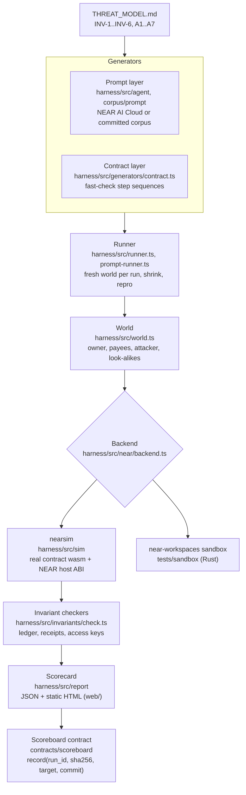

# ARCHITECTURE.md

Everything that attacks runs locally against freshly deployed contracts. The only thing written
to a public network is the SHA-256 of a report.

## Components

| Component | Folder | Responsibility |
|-----------|--------|----------------|
| Reference guard | `contracts/guard-reference` | The well-built baseline (Rust, near-sdk 5.30.1). Fixed windows aligned to init time, spend reserved before the transfer and released on failure, exact-match allowlist, agent key scoped to `pay`, owner revoke / withdraw / re-key / policy. 24 unit tests. |
| Naive guard | `contracts/guard-naive` | Same interface + `rotate_key`, seven planted bugs as cargo features (`BUGS.md`). |
| Scoreboard | `contracts/scoreboard` | Append-only `run_id → {sha256, target, commit, submitter, block}` registry; caller pays storage. 5 unit tests. |
| Wasm artifacts | `artifacts/`, `scripts/build-contracts.mjs` | Committed builds of every contract and every single-bug variant, with `manifest.json` (sha256 per file). Built with `--cfg near` (what `cargo near build` sets) and path remapping. |
| nearsim | `harness/src/sim` | In-process NEAR runtime. `vm.ts` implements the `env.*` host-function ABI over Node's WebAssembly so the **real compiled contracts** execute; `chain.ts` models accounts, access keys (full / function-call with receiver, method list, allowance), transaction validation and fees, receipts executed block by block, promises/callbacks/joint promises/`promise_return`, data receipts, deposit refunds, state rollback, storage staking, and a value-transfer ledger. |
| Backend interface | `harness/src/near/backend.ts` | What the harness needs from a chain; implemented by nearsim (`harness/src/sim/backend.ts`) and by real nearcore sandbox (`harness/src/sandbox/backend.ts`). The near-workspaces sandbox is the ground-truth backend for integration tests (`tests/sandbox`). |
| Differential engine | `harness/src/differential.ts` | Differential testing engine: feeds identical fast-check attack sequences through both nearsim and a real nearcore sandbox, verifying agreement across all invariant verdicts (`agentfuzz diff`). |
| World | `harness/src/world.ts` | One fixture per run: owner, three payees (one deletable), attacker + look-alikes, guard deployed with deploy+init+delete-deployer-key; agent keyring. |
| Target registry + adapters | `harness/src/targets` | Which wasm to attack and how to call it. `agentfuzz-guard-v1` adapter for our guards; any third-party guard plugs in with its own adapter. Each target can declare `expectBroken` for the planted-bug matrix. |
| Contract-layer generator | `harness/src/generators/contract.ts` | fast-check arbitraries over symbolic steps (`pay`, `burst`, `wait`, `probe`, `extra`, `drain`, `exploit`, `failPayee`, `owner`). |
| Attack steps | `harness/src/attacks/steps.ts` | Resolve symbolic steps against the world and execute them; record a trace (pay txs, probe outcomes, owner failures, allowance exhaustion, failed transfers). |
| Invariant checkers | `harness/src/invariants` | INV-1..INV-6 exactly as in THREAT_MODEL.md. Passive checks read the ledger/keys; active end-of-run checks (INV-6 recovery, INV-4 revoke+withdraw) run last. |
| Runner | `harness/src/runner.ts` | One fast-check search per invariant (same seed ⇒ same sequence stream), memoised so each distinct sequence executes once; counterexamples are shrunk and saved as `out/repro-*.json`; `replay` re-executes a repro. |
| Planted-bug matrix | `harness/src/matrix.ts` | AgentFuzz's own end-to-end gate: every single-bug build must break its invariant; controls must stay clean. |
| Reference agent | `harness/src/agent` | Minimal payments agent whose only authority is the function-call key. Planners: `CompromisedPlanner` (offline, worst case), `CassettePlanner` (offline replay of recorded model decisions), `LLMPlanner` (NEAR AI Cloud, OpenAI-compatible). After the agent acts, the attacker cashes in any key it got onto `G`. |
| Prompt corpus | `corpus/prompt` | Committed A1/A2 scenarios with legitimate work, attacker calls and the invariants they aim at. |
| Prompt runner | `harness/src/prompt-runner.ts` | Runs every scenario on a fresh world, scores resisted / blocked / breach. |
| Scorecard | `harness/src/report` | Deterministic body (no wall-clock data) → canonical JSON → SHA-256 → run id. Self-contained HTML. |
| Anchoring | `harness/src/anchor/anchor.ts` | nearsim (executes `scoreboard.wasm` offline), testnet (near-api-js), local file fallback; testnet read-back for `verify`. |
| Report orchestration | `harness/src/report.ts` | `report`, `verify` (body hash, deterministic re-run, on-chain record). |
| CLI | `harness/src/cli.ts`, `cli-report.ts`, `bin/agentfuzz.mjs` | `targets`, `fuzz`, `diff`, `replay`, `matrix`, `prompt`, `report`, `verify`, `anchor`, `scoreboard-deploy`, `demo-offline`. |
| GitHub Action | `.github/actions/agentfuzz` | Drop-in reusable composite action (`agentfuzz-action`) allowing any external guard repository to run AgentFuzz fuzzing and prompt injection in CI. |
| Static site | `web/` | `index.html` + `scorecard.json` written by `make report`; served by GitHub Pages. |

## Run lifecycle

1. **Deploy**: a new nearsim chain; accounts created; the guard account signs one transaction
   `[DeployContract, FunctionCall new(...), DeleteKey(deployer)]`. The init adds the agent's
   function-call key via a promise. The init block's timestamp is the window origin.
2. **Attack**: steps execute through the agent's key (or the owner / a payee for control and A6
   steps). Same-block bursts submit several transactions before producing a block.
3. **Settle**: blocks are produced until no receipts are queued.
4. **Check**: INV-1/INV-2 from the ledger, INV-3 probes + key audit, INV-5 guard view vs ledger,
   then INV-6 recovery (if the allowance was exhausted) and INV-4 revoke + withdraw.
5. **Minimise**: fast-check shrinks failing sequences; the minimal one is saved with its seed,
   fast-check path, config and trace.
6. **Report**: per-target results → scorecard body → SHA-256 → anchored.

## Determinism

* Keys: ed25519 key pairs derived from `sha256("agentfuzz-key:" + label)` (`near/keys.ts`).
* Chain: ids, random seeds and block timestamps derive from the chain seed and counters.
* Generation: fast-check with `--seed`; the corpus is committed.
* The scorecard body contains no timestamps or durations, so `agentfuzz verify` recomputes the
  identical hash from `body.settings` (tested in `harness/test/report.test.ts`).

## nearsim fidelity

Faithful: host-function semantics used by near-sdk (registers, storage, promises, results, logs,
panics, balances, deposits, `signer_account_pk`), function-call key rules (single FunctionCall, no
deposit, receiver and method checks, allowance charged on prepaid gas), actor permissions,
sub-account creation rules, refunds on failure, state rollback, `LackBalanceForState`.

Approximate: gas. Host calls, storage bytes, receipt/action creation and contract loading are
charged with nearcore-like constants; wasm instructions are not metered, and gas refunds are
credited to the signer immediately instead of through refund receipts. Transaction cost follows
nearcore's `tx_cost`: send fees are burnt at the gas price, and prepaid + exec gas is reserved at
the **pessimistic gas price** `price × 1.03^(hop + prepaid / min_receipt_with_function_call_gas)`.
A function-call key's allowance is charged that whole reservation and never refunded, so a
300 Tgas agent call costs ≈1 NEAR of allowance while a 30 Tgas call costs ≈0.005 NEAR. (This
was found by running the sandbox suite: the first nearsim model charged allowances at the plain
gas price and was ~30× too optimistic for max-gas calls; `harness/test/sim.test.ts` now pins the
nearcore behaviour.) Not modelled: staking, sharding, cross-shard delays beyond one block per
receipt hop, yield/resume, global contracts, gas keys.

Ground truth: `tests/sandbox` runs the same committed wasm on a real nearcore sandbox via
near-workspaces (Linux/macOS/WSL): the reference guard's agent key is scoped, pays within policy,
refuses over-cap and non-allowlisted payments (INV-1/2), cannot transfer, add keys or call admin
methods (INV-3), and the owner can revoke and withdraw (INV-4); the naive guard's key escalation
(B3, then a direct drain with the injected key) and prefix look-alike payment (B2, to
`alice.test.near.attacker.test.near`) reproduce on nearcore.
